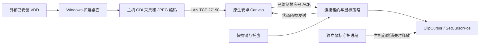

# 实现结构和约定

## 文件职责

- `src/TabletExtend.Core/MousePolicy.cs`：线程串行化状态机，首次/重连关闭、强制锁定优先、帧确认租约、失败释放。可在 Linux 用模拟游标运行。
- `FrameServer.cs` / `Wire.cs`：配对、单客户端会话、状态/图像/确认、断联恢复。有界握手、包长、超时、最多四条待处理连接。
- `src/TabletExtend.Windows/DisplayCapture.cs`：拒绝主屏、拒绝重叠范围；采集真实扩展桌面，叠加当前鼠标形状/位置；选定扩展屏位置调整。
- `Hotkeys.cs`：普通组合 RegisterHotKey＋冲突提示/备用；Ctrl+Win 钩子仅识别干净的修饰键组合，在第一次修饰键松开时切换一次。
- `TrayApplication.cs`：托盘、设置、显示拓扑事件、250 ms 租约/限制检查、主机守护心跳。
- `CursorGuardian.cs`：独立进程，通过仅当前用户 NamedPipe 接收主机 UI 心跳，2 秒无心跳或 EOF 后释放限制并移回主屏。
- `android/.../MainActivity.java`：原生 socket 客户端、连接重试、进入后台断开、返回后重新连接；不发送触控输入。
- `DisplayView.java`：Canvas 显示、红绿鼠标与锁标记；绘制完成后才确认帧，断联清除过期绿色状态和画面。

## 状态与优先级

| 事件 | Connected | Allowed | Locked | 鼠标动作 |
| --- | --- | --- | --- | --- |
| 首次启动 | 否 | 否 | 否 | 释放旧限制，回主屏 |
| 首帧绘制确认/重连 | 是 | 否 | 保留当前锁状态 | 回主屏、限主屏 |
| 普通切换，未锁且连接健康 | 是 | 取反 | 否 | 开：释放；关：回主屏、限主屏 |
| 普通切换，强制锁定中 | 是 | 否 | 是 | 保持限制 |
| 强制锁定开/关 | 不变 | 否 | 取反 | 连接健康时回主屏、限主屏 |
| EOF/读写失败/确认超时 | 否 | 否 | 保留 | **释放所有限制**，回主屏 |
| 主屏/显示拓扑变化 | 先设否 | 否 | 保留 | 先释放，重新核对；下一次有效帧确认后重新按主屏范围限制 |
| 主进程结束/卡死 | — | — | — | 守护进程释放并回主屏 |

强制锁定在同一次运行的断联/重连期间保留，避免普通切换间接解除强制锁；退出程序后不持久保存锁状态，下一次启动仍跨屏关闭。

断联时用户明确要求释放残留限制，所以断联优先于“强制锁”。虚拟显示器保留，鼠标回到主屏后系统仍可能允许再次移入保留的虚拟桌面；不存在健康连接时，本项目不会偷偷重新 ClipCursor。若需要断联后同时禁用虚拟显示器，可作为另一个明确功能添加，不改变当前窗口保留行为。

关闭跨屏只操作鼠标，不移动窗口，不禁用虚拟屏，不停止网络传输。换位置/换屏/修改连接配置会短暂断开会话，重新连接时关闭跨屏。

## TCP v1

包头 5 字节：`type:uint8` ＋ `payloadLength:int32 big endian`，随后精确长度载荷。不得负长度、超限分配、读半包后当作成功。

| type | 方向 | 载荷 |
| --- | --- | --- |
| 1 HELLO | 安卓→Windows | UTF-8 JSON `{"version":1,"token":"64位HEX"}`，最多 1024 字节 |
| 2 STATUS | Windows→安卓 | UTF-8 JSON `connected/allowed/locked/error` |
| 3 FRAME | Windows→安卓 | `sequence:int64 big endian` ＋ JPEG（上限 16 MiB） |
| 4 ACK | 安卓→Windows | 恰好 8 字节序号，必须与当前待确认帧一致 |
| 5 ERROR | Windows→安卓 | JSON message（配对或忙碌等） |

发送一个状态＋一帧，等待绘制确认，再按目标 fps 间隔采集下一帧。没有无限排队或多个图像在网络中积压。ACK 只证明安卓 Canvas 完成绘制调用，不等同面板扫描输出的硬件时间戳。

配对码采用 256-bit 随机值、常量时间比较；仅一个已认证接收者占有会话，另一个不会重置现有鼠标状态。传输没有 TLS，局域网旁路观察者可能读到配对码和画面，所以只在可信 LAN 上用；绑定具体 IPv4，防火墙限定 Private/LocalSubnet，无云中继，不开放公网。

## 设备测试特别关注

`DISPLAYn` 编号不稳定，所以启动时不自动恢复上次屏幕选择。菜单提供适配器名称；名称无法确认 VDD 时需要人工核对。即使菜单名称显示 VDD，也仍需验证实际 Windows 第二桌面内容。

Win32 鼠标/键盘控制作用于交互式用户桌面。Raw Input 游戏、反作弊、其他 ClipCursor 调用者、安全桌面和屏幕锁定不属于云端状态机测试证明的范围。Ctrl+Win 钩子不吞按键，以免留下不一致 Windows 键状态，可能打开开始菜单；建议实机后选择更稳妥组合。
